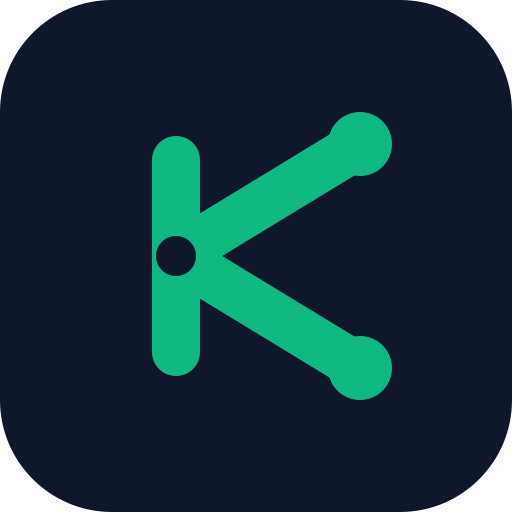

### MyKnowledgeBoard
<p align="center">

</p>

**Knowledge. Within Reach.**
A multi-tenant organizational knowledge board built on the MERN stack. Enables employees to submit, search, and bookmark company-specific process guides and policies, managed through a hierarchical approval workflow.
#### Core Features
*   **Multi-Tenant Architecture:**  Isolated organizational environments governed by companyId scoping and email domain verification.
*   **Role-Based Access Control (RBAC):**  Distinct permission tiers for Employees, Managers, and Admins.
*   **Approval Workflow:**  State-driven content lifecycle management (Draft, Pending, Approved, Rejected) with manager feedback integration.
*   **Asset Management:**  Integrated Cloudinary pipeline for user avatar processing and automated cascading cleanup.
*   **Contextual Discovery:**  MongoDB $text indexing for high-relevancy search across organizational documentation.
*   **MyKnowledge Assistant:**  An AI chatbot that will answer a user's questions regarding a company's workplace policies or procedures.


---


#### Technical Stack
| Domain | Technology |
| ------ | ------ |
| **Frontend** | React, Vite, React Router DOM, TinyMCE, Lucide React, Web Sockets, UUID |
| **Backend** | Node.js, Express, Mongoose, JSON Web Tokens (JWT), Bcryptjs, Leo-Profanity, Web Sockets |
| **Database** | MongoDB |
| **Services** | Cloudinary (Image Hosting) |


---


#### Environment Configuration
```
Create a `.env` file in the `server` directory with the following variables:

    # Cloudinary Configuration
    CLOUDINARY_CLOUD_NAME=your_cloud_name
    CLOUDINARY_KEY=your_api_key
    CLOUDINARY_SECRET=your_api_secret
    CLOUDINARY_URL=your_cloudinary_url

    # Server Configuration
    JWT_SECRET=your_jwt_secret_key
    MONGO_URI=your_mongodb_connection_string
    FRONTEND_URL=http://localhost:5173
    NODE_ENV=development
    CLIENT_URL=http://localhost:5173
    PORT=5000

    # Send Grid Configuration
    EMAIL_USERNAME=your_sendgrid_username
    EMAIL_PASSWORD=your_sendgrid_password
    FROM_NAME=your_email_from_name
    FROM_EMAIL=your_email_from_email
    SENDGRID_API_KEY=your_sendgrid_api_key

    # Stripe Configuration
    STRIPE_SECRET_KEY=your_stripe_secret_key
    STRIPE_WEBHOOK_SECRET=your_stripe_webhook_secret

    # Gemini Configuration
    GEMINI_API_KEY=your_gemini_api_key

Create a `.env` file in the `client` directory with the following variables:

    # Client Configuration
    VITE_API_URL=http://localhost:5000

    # Tiny MCE Configuration
    VITE_TINYMCE_API_KEY=your_tinymce_api_key

    # Stripe Configuration
    VITE_STRIPE_PUBLISHABLE_KEY=your_stripe_publishable_key

```
#### Installation & Execution
```
1. Install Dependencies (Root, Client, and Server):

    npm run install-all

2. Initialize Development Servers (Concurrent execution):

    npm run dev

    *   Frontend: `http://localhost:5173`
    *   Backend: `http://localhost:5000`

```


---


#### System Architecture


---


##### Database Models
**1. User Model**
| Field | Type | Constraints | Description |
| :--- | :--- | :--- | :--- |
| `companyId` | ObjectId | required, ref: 'Company' | Maps user to specific tenant |
| `firstName` | String | required | User's given name |
| `lastName` | String | required | User's family name |
| `email` | String | required, unique | Auth and domain verification |
| `password` | String | required | Hashed via bcrypt pre-save |
| `role` | String | enum: ['Employee', 'Manager', 'Admin'] | Defines RBAC permissions |
| `managerId` | ObjectId | default: null, ref: 'User' | Hierarchical reporting structure |
| `avatar` | String | optional | Cloudinary secure URL |
| `avatarPublicId` | String | default: "" | Cloudinary asset ID for cleanup |
| `favoriteArticles` | [ObjectId] | ref: 'Article' | Array of bookmarked articles |
| `isAdmin` | Boolean | default: false | System-level admin override |
| `resetPasswordToken`| String | optional | Hashed token for password recovery |
| `resetPasswordExpire`| Date | optional | Token validity window |

**2. Company Model**
| Field | Type | Constraints | Description |
| :--- | :--- | :--- | :--- |
| `name` | String | required, unique, trim | Display name of the organization |
| `emailDomain` | String | required, unique, lowercase | RegEx validated domain |
| `isActive` | Boolean | default: true | Soft-disable toggle for tenant |
| `createdBy` | ObjectId | ref: 'User' | User who registered the workspace |

**3. Article Model**
| Field | Type | Constraints | Description |
| :--- | :--- | :--- | :--- |
| `companyId` | ObjectId | required, ref: 'Company' | Scopes article to tenant |
| `authorId` | ObjectId | required, ref: 'User' | Article creator |
| `title` | String | required, text index | Article heading |
| `content` | String | required, text index | HTML/Markdown payload |
| `tags` | [String] | text index | Categorization terms |
| `status` | String | enum: ['Draft', 'Pending', 'Approved', 'Rejected'] | Content lifecycle state |
| `approverId` | ObjectId | default: null, ref: 'User' | Manager executing final review |
| `rejectionReason` | String | default: null | Feedback payload for rejected status |
| `viewCount` | Number | default: 0 | Increments on GET request |


---


##### API Routes
**Authentication Routes (`/api/auth`)**
| Method | Endpoint | Controller | Access |
| :--- | :--- | :--- | :--- |
| `POST` | `/register` | `registerUser` | Public |
| `POST` | `/login` | `loginUser` | Public |
| `POST` | `/logout` | `logoutUser` | Public |
| `POST` | `/forgotpassword` | `forgotPassword` | Public |

**Company Routes (`/api/companies`)**
| Method | Endpoint | Controller | Access |
| :--- | :--- | :--- | :--- |
| `GET` | `/` | `getCompanies` | Public |
| `POST` | `/register` | `registerCompany` | Public |

**User Routes (`/api/users`)**
| Method | Endpoint | Controller | Access |
| :--- | :--- | :--- | :--- |
| `GET` | `/profile` | `getUserProfile` | Private |
| `PUT` | `/profile` | `updateUserProfile` | Private |
| `DELETE` | `/profile` | `deleteUser` | Private |
| `GET` | `/directory` | `getCompanyDirectory` | Private |
| `GET` | `/managers` | `getCompanyManagers` | Private |
| `PATCH` | `/favorites/:articleId` | `toggleFavoriteArticle` | Private |

**Article Routes (`/api/articles`)**
| Method | Endpoint | Controller | Access |
| :--- | :--- | :--- | :--- |
| `POST` | `/` | `createArticle` | Private |
| `GET` | `/` | `getArticles` | Private |
| `GET` | `/:id` | `getArticleById` | Private |
| `PUT` | `/:id` | `updateArticle` | Private (Author) |
| `PATCH` | `/:id/status` | `approveRejectArticle` | Private (Manager) |
| `GET` | `/my-articles` | `getUserArticles` | Private |
| `GET` | `/pending` | `getPendingArticles` | Private (Manager) |


---


#### Frontend Architecture
The client application is built with React and Vite, utilizing a feature-based directory structure for modularity and scalability.


##### Client Architecture (`client/src`)

| Module / Directory | Key Files & Components | Architectural Responsibility |
| :--- | :--- | :--- |
| **`components/Layout`** | `NavBar`, `SideBar`, `Footer`, `Header`, `Toast`, `SplashScreen` | App shell, navigation, animated circuit logo splash, global alert toasts |
| **`components/Article`** | `ArticleEditor`, `ArticleView`, `ArticleCard`, `ArticleFeedback`, `PinButton`, `TopArticles` | Rich-text authoring with TinyMCE, live viewer presence, feedback voting, favorites |
| **`components/Auth`** | `Login`, `Register`, `ForgotPassword`, `ResetPassword`, `VerifyWorkspace`, `ProfileSettings` | User authentication, token password recovery, tenant workspace verification |
| **`components/Dashboards`** | `EmployeeDashboard`, `ManagerDashboard`, `ApprovalQueue`, `ReviewQueue` | Role-based landing hubs, pending review queues, and content expiration trackers |
| **`components/Company`** | `CompanyList`, `CompanyRegistration`, `WorkspaceManagement` | Multi-tenant onboarding, participating company directory, department catalogs |
| **`components/Chatbot`** | `Chatbot.jsx`, `chatbot.css` | Global floating conversational AI assistant with source citations |
| **`components/Search`** | `SearchBar`, `SearchResults`, `TagFilter` | MongoDB text-indexed search, query parameters, department & tag filters |
| **`components/Notifications`** | `NotificationBell.jsx`, `notifications.css` | Real-time WebSocket notification dropdown for approval and review alerts |
| **`components/UserManagement`** | `UserManagement.jsx`, `CreateElevatedUser.jsx` | Administrative user directory, manager assignment, and role provisioning |
| **`components/Utility`** | `ProtectedRoute.jsx`, `AdminRoute.jsx` | React Router access guards enforcing authentication and Manager/Admin RBAC |
| **`components/Widgets`** | `ProrationWidget`, `BandwidthWidget`, `TroubleshootingWidget` | Dynamic calculation engines embedded into SOP articles via shortcodes |
| **`contexts/`** | `AppProvider`, `FetcherContext`, `AuthContext`, `SocketContext`, `CompanyContext` | Global state tree resolving dependencies in strict hierarchical order |
| **`hooks/`** | `useAuth`, `useCompany`, `useFetcher`, `useSocket` | Encapsulated custom hooks for credentialed HTTP calls, auth state, and sockets |


##### Server Architecture (`server`)

| Directory | Key Files | Architectural Responsibility |
| :--- | :--- | :--- |
| **`controllers/`** | `authController`, `companyController`, `userController`, `articleController`, `aiController`, `chatController`, `notificationController`, `sessionController` | Business logic, database queries, and async error handling across all 9 route domains |
| **`models/`** | `User.js`, `Company.js`, `Article.js`, `Notification.js`, `SessionLog.js`, `ContentGapLog.js` | Mongoose schemas, text & vector indexes, validation enums, and cascading pre-delete middleware |
| **`routes/`** | `authRoutes`, `companyRoutes`, `userRoutes`, `articleRoutes`, `aiRoutes`, `chatRoutes`, `notificationRoutes`, `sessionRoutes`, `analyticsRoutes` | Express endpoint definitions mapping HTTP verbs and mounting middleware pipelines |
| **`middleware/`** | `authMiddleware.js`, `cloudinary.js`, `errorHandler.js`, `moderationMiddleware.js` | JWT cookie validation, RBAC checks, Multer Cloudinary storage, profanity filtering |
| **`utils/`** | `generateToken.js`, `sendEmail.js` | Cookie-based JWT generation and SendGrid transactional email dispatch |
| **Entry Points** | `server.js`, `app.js` | HTTP server initialization, Socket.IO room setup, and Express middleware configuration |


---


##### Component Breakdown
*  Article: Manages the core knowledge base content lifecycle. Includes the editor interface, standardized card displays, detailed viewing, and the manager-specific approval queue interface.
*  Auth: Handles system access and onboarding. Includes standard login, employee registration, and the secure workspace verification flow.
*  Company: Interfaces for the multi-tenant architecture. Displays active participating organizations and handles the creation of new tenant workspaces.
*  Dashboards: Role-specific landing areas providing contextual data and actions based on whether the authenticated user is an Employee or a Manager.
*  Layout: The persistent UI shell. Contains navigation bars, footers, sidebars, and the global notification system (Toast).
*  Pages: Top-level route views, such as the public-facing Home page.
*  Search: Components interfacing with the backend MongoDB text-indexing to provide high-relevancy document discovery and tag-based filtering.
*  Utility: Higher-order components and wrappers, primarily used for Role-Based Access Control (RBAC) to restrict access to protected and admin-only routes.
##### State Management & Data Fetching
*  Contexts (AppProvider.jsx): Global state is segmented by domain (Auth, Companies, Fetcher) and nested hierarchically within a primary provider to ensure correct dependency resolution (e.g., Company state relying on Auth state).
*  Custom Hooks:
    *  useAuth: Exposes login, logout, and current user data.
    *  useCompany: Exposes current tenant data.
    *  useFetcher: A centralized utility for executing API requests with intercepted credentials and error handling.


---


#### Security & Architecture Conventions

***Decoupled API Consumption:** All client-side network calls are routed through the custom `useFetcher()` hook. Raw `fetch` or `axios` instances are never used directly within UI components.

***Cookie-Based Sessions:** Authentication JSON Web Tokens are passed in `httpOnly`, `sameSite: "Strict"`, and `secure` (in production) cookies, mitigating CSRF and XSS attack vectors.

***Argon2id Cryptography:** User passwords are encrypted with memory-hard Argon2id. A non-disruptive auto-migration routine upgrades older bcrypt passwords on successful login.

***Cascading Cleanup Middleware:** Mongoose `pre('deleteOne')` lifecycle hooks guarantee that deleting a user or company workspace systematically purges associated Cloudinary media assets and related records.

***Zero Secret Leakage:** External AI keys, database credentials, and SendGrid tokens remain isolated strictly within the backend Node runtime.
