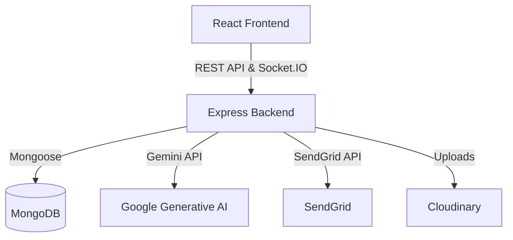

# My Knowledge Board — Repository Overview

## What this project is

My Knowledge Board is a multi-tenant internal knowledge platform built with the MERN stack. It allows organizations to manage and discover internal process documentation with role-based access, review workflows, and AI-assisted support.

## Key technologies

| Layer | Technologies |
| --- | --- |
| Frontend | React 19, Vite, React Router, Bootstrap/React-Bootstrap, TinyMCE |
| Backend | Node.js, Express, Mongoose |
| Database | MongoDB |
| Auth & Security | JWT, bcryptjs, cookie-parser, CORS, helmet, express-rate-limit |
| Real-time | Socket.IO (server + client) |
| Integrations | Google Generative AI, Cloudinary, SendGrid, Nodemailer |
| Tooling | ESLint, Prettier, Husky, lint-staged, nodemon, concurrently |

## Architecture Diagram



## High-level codebase structure

```text
my-knowledge-board/
├── client/                      # React frontend (Vite)
│   ├── src/
│   │   ├── App.jsx              # Route definitions and route guards
│   │   ├── components/          # Feature-based UI components
│   │   ├── contexts/            # App-wide providers (Auth, Socket, Fetcher, Company)
│   │   ├── hooks/               # useAuth/useSocket/useFetcher/useCompany
│   │   └── main.jsx             # App bootstrap
│   └── package.json
├── server/                      # Express API backend
│   ├── server.js                # Server startup, Mongo connection, Socket.IO setup
│   ├── app.js                   # Middleware + route mounting
│   ├── controllers/             # Request handlers/business logic
│   ├── models/                  # Mongoose schemas
│   ├── routes/                  # API route modules
│   ├── middleware/              # Auth, error handling, moderation, Cloudinary helpers
│   ├── utils/                   # Token and email helpers
│   └── package.json
├── package.json                 # Root scripts for multi-package workflows
└── README.md
```

## Frontend organization (`/client/src`)

### Routing and access control
- `App.jsx` defines public, authenticated, and admin/manager-only routes.
- Route guards:
  - `components/Utility/ProtectedRoute` for authenticated users
  - `components/Utility/AdminRoute` for elevated roles

### Feature-based component folders
- `components/Article` — editor, review, viewing, voting/feedback
- `components/Auth` — login, registration, verification, profile settings
- `components/Dashboards` — employee and manager dashboard screens
- `components/Search` — search bar, result listing, filtering
- `components/Notifications` — notification UI
- `components/Chatbot` — in-app assistant UI
- `components/Admin` — workspace and session log admin views

### State management pattern
- `contexts/AppProvider.jsx` composes providers in this order:
  1. `FetcherProvider`
  2. `AuthProvider`
  3. `SocketProvider`
  4. `CompanyProvider`
- Hooks expose each context via:
  - `useFetcher`, `useAuth`, `useSocket`, `useCompany`

## Backend organization (`/server`)

### Entry points
- `server.js`: loads env vars, validates `MONGO_URI`, connects MongoDB, creates HTTP server, attaches Socket.IO, and starts listening.
- `app.js`: configures middleware (`cors`, `cookie-parser`, JSON/urlencoded parsers), mounts all API routes, and applies global error handling.

### API route modules
- `routes/authRoutes.js` → `/api/auth`
- `routes/companyRoutes.js` → `/api/companies`
- `routes/userRoutes.js` → `/api/users`
- `routes/articleRoutes.js` → `/api/articles`
- `routes/aiRoutes.js` → `/api/ai`
- `routes/chatRoutes.js` → `/api/chat`
- `routes/notificationRoutes.js` → `/api/notifications`
- `routes/sessionRoutes.js` → `/api/sessions`

### Core data models
- `models/User.js`
  - multi-company association, role array (`Employee`, `Manager`, `Admin`)
  - password hashing via pre-save hook
  - verification and reset token methods
  - avatar metadata and Cloudinary cleanup on delete
- `models/Article.js`
  - article lifecycle status (`Draft`, `Pending`, `Approved`, `Rejected`)
  - department scoping, tags, feedback, upvotes/downvotes
  - weighted text index for search relevance
- `models/Company.js` — tenant/workspace data
- `models/Notification.js` — user notification records
- `models/SessionLog.js` — session/admin log tracking

## Notable architectural patterns

1. **Multi-tenancy:** company-scoped data boundaries.
2. **RBAC:** Employee/Manager/Admin role-based restrictions across frontend and backend.
3. **Approval workflow:** managed article review and status transitions.
4. **Realtime notifications:** Socket.IO user-room model (`join_user_room`).
5. **AI integration:** backend AI/chat routes for assistant capabilities.

## Useful root scripts

- `npm run install-all` — installs root, client, and server dependencies
- `npm run dev` — runs frontend and backend in parallel
- `npm run client` — starts frontend dev server
- `npm run server` — starts backend in dev mode
- `npm run start` — starts backend in production mode

## Package-specific scripts

### Client (`client/package.json`)
- `npm run dev --prefix client`
- `npm run build --prefix client`
- `npm run lint --prefix client`

### Server (`server/package.json`)
- `npm run dev --prefix server`
- `npm run start --prefix server`
